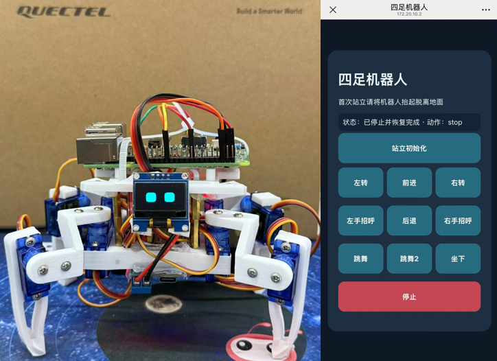

# Quectel Pi M2 Quadruped Robot

English | [中文](README_zh.md)

A desktop quadruped robot example based on the **Quectel Pi M2**. The project is developed in C, drives eight servos through a PCA9685, displays animated eye expressions on an SSD1306 OLED, and provides both command-line and browser-based control.

## Quadruped Robot



## Features

- Coordinated control of eight servos.
- Supports standing, sitting, moving forward and backward, turning left and right, waving with either side, and two dance routines.
- The Web page provides motion controls, stop control, and operating status feedback.
- OLED expressions change in coordination with robot motion.
- The OLED supports blinking, looking around, and multiple animated expressions.

## Hardware List

| Hardware | Quantity |
| --- | :---: |
| Quectel Pi M2 | 1 |
| PCA9685 servo driver module | 1 |
| Servos | 8 |
| SSD1306 OLED | 1 |
| Quadruped robot mechanical frame | 1 set |
| Independent servo power supply | 1 |
| Step-down power module | 1 |

## Wiring and Usage Guides

- [Wiring, Calibration and Usage Guide](docs/wiring-calibration-usage.md)

## Build Environment

Install the required tools:

```bash
sudo apt update
sudo apt install build-essential
```

## Quick Start

### 1. Get the Source Code

```bash
cd /root
git clone https://github.com/Quectel-Pi/demo-quadruped-robot.git
cd demo-quadruped-robot
```

### 2. Build the Project

```bash
make
```

The build produces two executables by default:

| Program | Purpose |
| --- | --- |
| `quadruped_robot` | Command-line control, servo debugging, and OLED testing |
| `quadruped_web` | Web control service |

## Project Structure

```text
demo-quadruped-robot/
├── docs/
│   ├── images/                    # Project images and demo video
│   ├── wiring-calibration-usage.md     # English wiring, calibration, and usage guide
│   └── wiring-calibration-usage_zh.md  # Chinese wiring, calibration, and usage guide
│
├── include/                       # Public interfaces for each module
│   ├── command.h                  # Command-line dispatch interface
│   ├── movement.h                 # Motion frames, motion sessions, and gait interface
│   ├── servo_control.h            # Servo IDs, calibration parameters, and control interface
│   ├── pca9685.h                  # PCA9685 initialization and PWM output interface
│   ├── oled.h                     # SSD1306 framebuffer and display interface
│   ├── face.h                     # Expression types, animation state, and update interface
│   ├── face_bitmaps.h             # Expression bitmap generation and rendering interface
│   └── web_control.h              # Web motion state and control interface
│
├── src/                           # C source code
│   ├── main.c                     # CLI entry point, signal handling, and program exit
│   ├── command.c                  # Command parsing and motion/servo/OLED command dispatch
│   │
│   ├── movement.c                 # Standing, gait, turning, waving, and dance sequences
│   ├── servo_control.c            # Joint-to-CH0–CH7 mapping and angle conversion
│   ├── pca9685.c                  # PCA9685 low-level driver using Linux I²C
│   │
│   ├── oled.c                     # SSD1306 initialization, drawing, and refresh
│   ├── face.c                     # Blinking, gaze, and motion expression state machine
│   ├── face_bitmaps.c             # Eye graphics generation and animation keyframes
│   │
│   ├── quadruped_web.c            # HTTP service, embedded page, and API handling
│   └── web_control.c              # Web motion thread, stop control, and state synchronization
│
├── .gitignore                     # Git ignore rules
├── LICENSE                        # Apache License 2.0
├── Makefile                       # CLI/Web build, link, and cleanup rules
├── README.md                      # English project documentation
└── README_zh.md                   # Chinese project documentation
```

## Demonstration
[Watch the quadruped robot demonstration video](docs/images/quadruped-robot.mp4)

## Issue Reporting
If you encounter any issues while using this project, please visit the [Quectel Official Forum](https://forumschinese.quectel.com/c/quectel-pi/58) for technical support. Our technical support team will be happy to assist you. We also welcome Issues and Pull Requests to help improve this project.