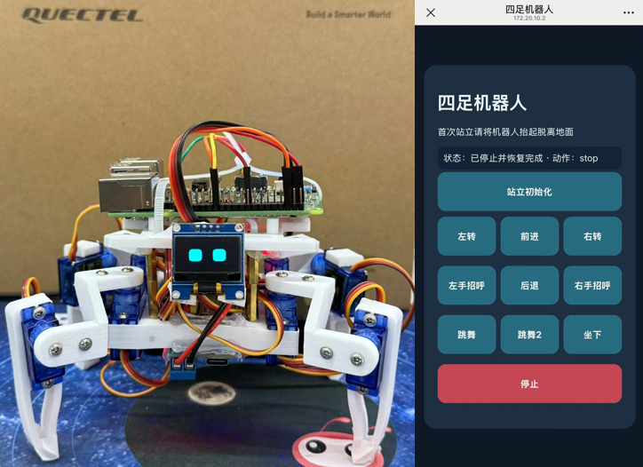

# Quectel Pi M2 四足机器人

[English](README.md) | 中文

基于 **Quectel Pi M2** 的桌面四足机器人示例。项目使用 C 语言开发，通过 PCA9685 驱动 8 路舵机，通过 SSD1306 OLED 显示动态眼睛表情，并同时提供命令行与浏览器控制方式。

## 四足机器人整机实物图



## 功能特性

- 8 路舵机联动。
- 支持站立、坐下、前进、后退、左右转向、左右挥手和两组舞蹈动作。
- Web 页面提供动作控制、停止控制和运行状态反馈。
- 机器人运动时可联动 OLED 表情。
- OLED 支持眨眼、注视及多种动态表情。

## 硬件清单

| 硬件 | 数量 |
| --- | :---: |
| Quectel Pi M2 | 1 |
| PCA9685 舵机驱动模块 | 1 |
| 舵机 | 8 |
| SSD1306 OLED | 1 |
| 四足机器人机械结构 | 1 套 |
| 独立舵机电源 | 1 |
| 电源降压模块 | 1 |

## 硬件连接与使用指南

- [四足机器人接线、舵机校准与使用指南](docs/wiring-calibration-usage_zh.md)

## 编译环境

安装常用工具：

```bash
sudo apt update
sudo apt install build-essential
```

## 快速开始

### 1. 获取代码

```bash
cd /root
git clone https://github.com/Quectel-Pi/demo-quadruped-robot.git
cd demo-quadruped-robot
```

### 2. 编译项目

```bash
make
```

默认会生成两个可执行程序：

| 程序 | 用途 |
| --- | --- |
| `quadruped_robot` | 命令行控制、舵机调试和 OLED 测试 |
| `quadruped_web` | Web 控制服务 |

## 项目结构

```text
demo-quadruped-robot/
├── docs/
│   ├── images/                    # 项目图片及演示视频
│   ├── wiring-calibration-usage.md     # 英文接线、校准与使用指南
│   └── wiring-calibration-usage_zh.md  # 中文接线、校准与使用指南
│
├── include/                       # 各功能模块的公共接口
│   ├── command.h                  # 命令行调度接口
│   ├── movement.h                 # 动作帧、动作会话与步态接口
│   ├── servo_control.h            # 舵机编号、校准参数与控制接口
│   ├── pca9685.h                  # PCA9685 初始化及 PWM 输出接口
│   ├── oled.h                     # SSD1306 帧缓冲与显示接口
│   ├── face.h                     # 表情类型、动画状态与更新接口
│   ├── face_bitmaps.h             # 表情位图生成与渲染接口
│   └── web_control.h              # Web 动作状态与控制接口
│
├── src/                           # C 语言源代码
│   ├── main.c                     # CLI 入口、信号处理与程序退出
│   ├── command.c                  # 命令解析及动作/舵机/OLED 命令分发
│   │
│   ├── movement.c                 # 站立、步态、转向、招手和舞蹈序列
│   ├── servo_control.c            # 关节到 CH0–CH7 的映射与角度换算
│   ├── pca9685.c                  # Linux I²C 下的 PCA9685 底层驱动
│   │
│   ├── oled.c                     # SSD1306 初始化、绘图及刷新
│   ├── face.c                     # 眨眼、注视和动作表情状态机
│   ├── face_bitmaps.c             # 眼睛图形生成与动画关键帧
│   │
│   ├── quadruped_web.c            # HTTP 服务、内置页面与 API 处理
│   └── web_control.c              # Web 动作线程、停止控制与状态同步
│
├── .gitignore                     # Git 忽略规则
├── LICENSE                        # Apache License 2.0 开源许可
├── Makefile                       # CLI/Web 编译、链接与清理规则
├── README.md                      # 英文项目说明文档
└── README_zh.md                   # 中文项目说明文档
```

## 效果演示
[点击查看四足机器人演示视频](docs/images/quadruped-robot.mp4)

## 问题反馈
如在使用过程中遇到问题，欢迎在[移远官方论坛](https://forumschinese.quectel.com/c/quectel-pi/58)提交技术咨询，我们的技术支持团队将及时为您解答。欢迎提交Issue和Pull Request来改进此项目。
